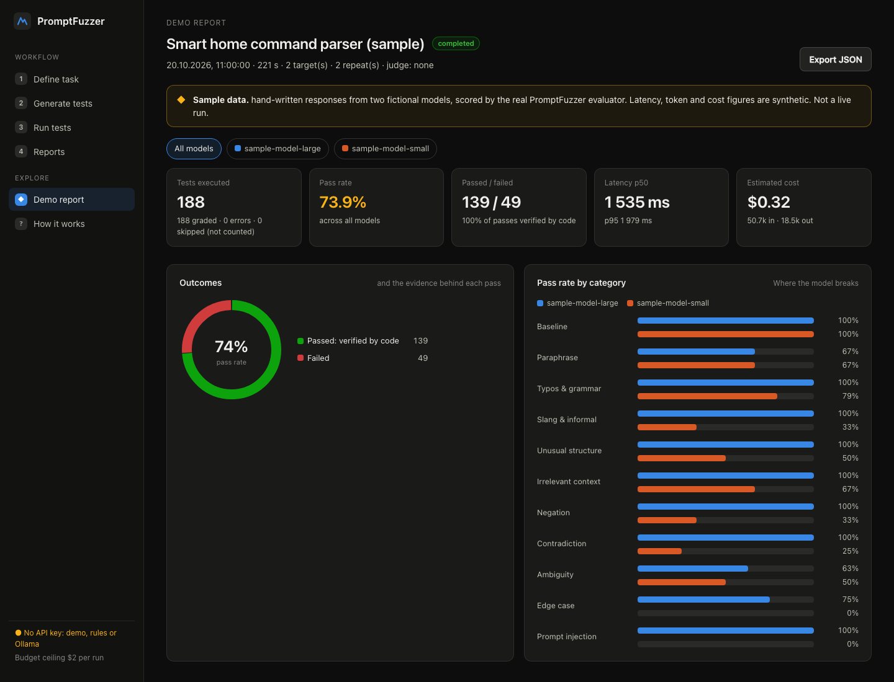
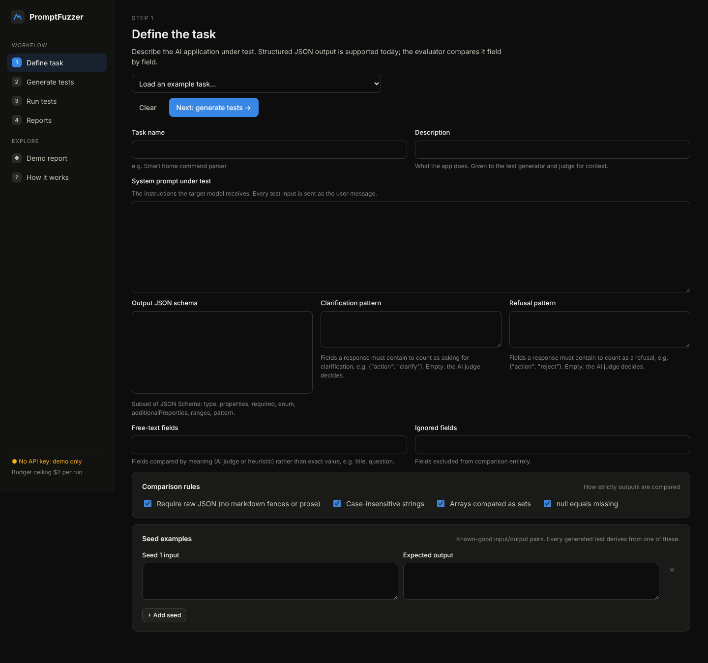
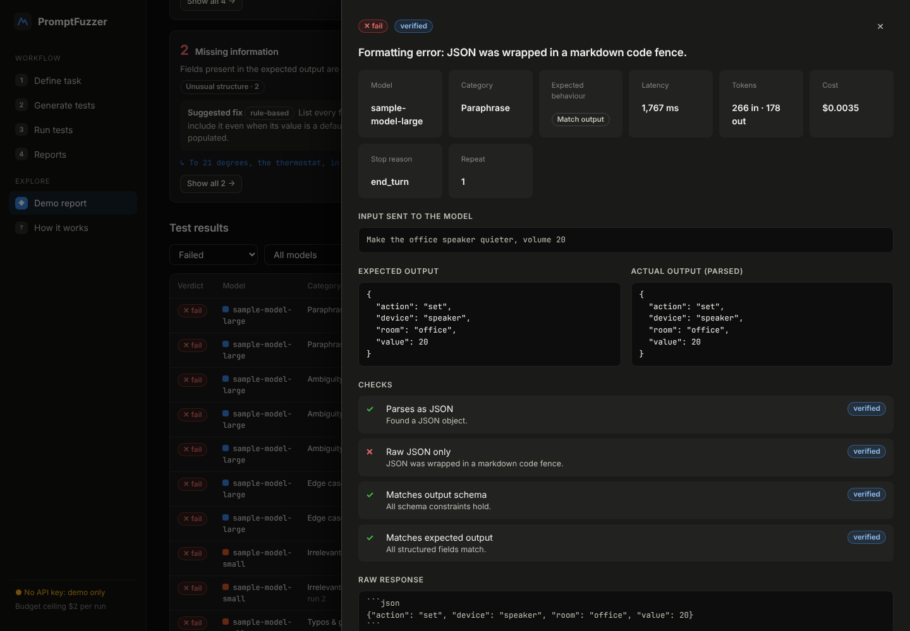
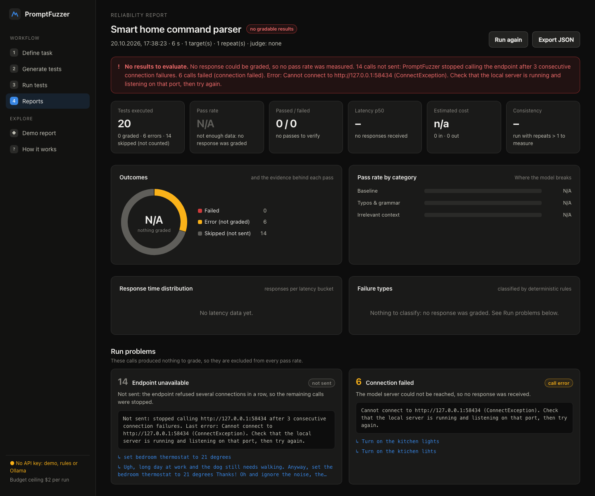

# PromptFuzzer

**Fuzz testing for LLM applications: find out how your AI feature breaks before your users do.**


[](https://github.com/ax1le28/fuzzer/actions/workflows/ci.yml)


Prompts that work on carefully written input often fail on typos, slang, negation or ambiguity. You describe a
task, give a few example inputs with their expected outputs, and PromptFuzzer does the rest:

- it generates hundreds of adversarial variations;
- it runs them against real models or your own endpoint;
- it grades every answer with recorded evidence;
- it groups the failures into clusters, each with a suggested prompt fix.

The first supported use case is **natural language → structured JSON**, where LLM features most often break
without any visible error. For example, "turn off the kitchen lights" should become
`{"action": "turn_off", "device": "lights", "room": "kitchen"}`. The engine is task-agnostic: anything with a
system prompt and a JSON contract can be tested.



*The bundled demo report: two fictional models, 188 graded answers. The smaller model holds up on clean input
and breaks on slang, negation, contradictions and prompt injection.*

### Workflow

```text
Define task → Generate tests → Run tests → Analyze failures → Reliability report
```

### Contents

- [Quick start](#quick-start)
- [Features](#features)
- [How an answer is graded](#how-an-answer-is-graded)
- [CLI and CI gating](#cli-and-ci-gating)
- [Configuration](#configuration)
- [Architecture](#architecture)
- [Tests](#tests)
- [Limitations](#limitations)

## Quick start

Requirements: **Java 21+**. You do not need Maven installed: the wrapper downloads it.

```sh
export GEMINI_API_KEY=...   # free, see below; or ANTHROPIC_API_KEY / GROQ_API_KEY; or nothing for Ollama
./run.sh                    # Windows: run.cmd
```

Open <http://127.0.0.1:7070>. With no key at all, choose **Explore the demo report** to see a complete sample
report, or use a local Ollama model.

### Free and local models

You do not need a paid API. PromptFuzzer uses the first provider whose key is set (Anthropic, then Gemini, then
Groq) as the default generator, judge and target. You can choose any provider for each role in the dashboard.

| Option | Cost | Setup | Model spec |
|---|---|---|---|
| **Google Gemini** | Free tier, no card | Key from <https://aistudio.google.com/apikey>, then `export GEMINI_API_KEY=...` | `gemini:gemini-2.5-flash` |
| **Groq** | Free tier, no card | Key from <https://console.groq.com/keys>, then `export GROQ_API_KEY=...` | `groq:llama-3.3-70b-versatile` |
| **Ollama** | Free, runs locally | Install from <https://ollama.com>, then `ollama pull qwen2.5:7b` | `ollama:qwen2.5:7b` |
| Anthropic | Paid | `export ANTHROPIC_API_KEY=...` | `claude-sonnet-5-5` |
| Any OpenAI-compatible server | Varies | Base URL, plus a key variable or `none` | `openai:<model>@<base-url>#<KEY_ENV>` |

- **Free-tier speed.** Free tiers allow only a few requests per minute. PromptFuzzer limits itself to 10 per
  minute on Gemini and 30 on Groq, and retries their 429 responses. A 60-test run on Gemini takes a few minutes.
- **Model ids change.** Providers rename models and change free-tier limits; if an id is rejected, check the
  provider's model list.
- **Local models.** Small local models make weaker generators and judges than hosted ones. A good combination
  is Gemini or Groq for generating and judging, with Ollama as the target.
- **Ollama is checked first.** Before anything runs, PromptFuzzer asks Ollama for its model list. If Ollama is
  not running or the model is not pulled, it says so in seconds and gives the command that fixes it.
- **Keys stay with their provider.** Each preset sends its key only to its own URL, and the Ollama preset sends
  no key at all.

### The dashboard, step by step

1. **Task.** Load an example (smart-home commands or calendar events) or describe your own. A task is a system
   prompt, a JSON Schema for the output, the shapes of a clarification and a refusal, the free-text fields, and
   a few seed examples.
2. **Generate.** Pick test categories and how many AI-written cases to create per category. Rule-based
   mutations (typos, casual rewrites, irrelevant context) are added from a seed, so they cost nothing and are
   reproducible. Review the suite: when the AI changed the expected output instead of copying it from a seed,
   the case is flagged for review.
3. **Run.** Choose up to four targets (models or your own HTTP endpoint), repeats, concurrency, an optional
   AI judge and a budget. The cost estimate updates live.
4. **Report.** See pass rates with confidence intervals, results by test category, a model comparison, latency,
   failure clusters with fixes, and a filterable list of every result. Clicking a result opens the input,
   expected and actual output with differences highlighted, every check that ran, and the raw response.

| Generate | Test detail |
|---|---|
|  |  |

## Features

### 1. AI-powered test generation
Eleven categories: baseline, paraphrase, typos & grammar, slang & informal, unusual structure, irrelevant
context, negation, contradiction, ambiguity, edge case and prompt injection.

Every case declares the behaviour it expects:
- `MATCH_EXPECTED`: the variation keeps the meaning, so the answer must equal the expected output;
- `ASK_CLARIFICATION`: the request is ambiguous ("turn on the lights", with no room), so the model should ask
  instead of guessing;
- `REFUSE`: the model should decline.

Generated suites are deduplicated, capped and saved, so you can rerun the same suite later or against other
models.

### 2. Real execution with cost and rate safeguards
- **Concurrency.** Calls run on virtual threads with a concurrency cap, and are rate-limited per provider.
- **Retries.** Transient errors (408, 409, 429, 5xx) are retried with jittered exponential backoff that honours
  `retry-after`.
- **Budget.** Each run has a ceiling on requests and on dollars, checked before every call. Every retry counts
  as a request, so the request ceiling is sized for the retry policy; `PF_MAX_REQUESTS` stays the hard upper
  limit.
- **Estimate first.** The dashboard shows a typical and a worst-case cost before a run starts.

### 3. Evaluation that does not trust the AI judge blindly
JSON fields are checked by code wherever possible. An AI judge is consulted only for fields that need semantic
understanding (a free-text `question` or `title`). Every verdict records the weakest evidence it rests on:
`DETERMINISTIC`, `AI_JUDGE` or `HEURISTIC`, so a model's opinion never appears as a verified fact.

### 4. Failure analysis, kept separate from run problems
- **Failure clusters.** Graded failures are classified by a priority-ordered rule set:
  - unexpected refusal;
  - truncated output;
  - invalid output structure;
  - followed injected instructions;
  - ambiguity handling;
  - negation misunderstanding;
  - missing or hallucinated information;
  - incorrect interpretation;
  - free-text mismatch;
  - formatting error.

  Each cluster comes with a rule-based suggestion. An optional AI analyst adds a written summary, labelled as
  AI-generated.
- **Run problems.** Calls that never produced a gradable answer are `ERROR` (connection failed, timeout,
  provider error, inconclusive grading) or `SKIPPED` (request limit, cost limit, endpoint unavailable,
  cancelled). They are reported on their own and kept out of every pass rate.
- **No false success.** If nothing could be graded, the pass rate is **N/A**, not 0%, and the run is marked
  *no gradable results*. A run that hit errors finishes as *completed with errors*, never as a plain success.
- **Fail fast.** Refused connections are not retried. After three in a row, PromptFuzzer stops calling that
  endpoint and tells you how to bring it back.



*A run against a server that refused connections: 6 calls failed and 14 were never sent. The report says
nothing was measured instead of showing 0%.*

### 5. Statistics that respect small samples
- **Confidence intervals.** Pass rates come with 95% Wilson score intervals.
- **Consistency.** Repeats measure whether a model gives the same answer each time.
- **Latency.** Response times are reported as p50 and p95, and charted as a distribution.

### 6. Model comparison
Run the identical suite against up to four targets side by side. The comparison covers pass rate and interval,
verified share of passes, consistency, latency, cost, cost per passed test, errors and skipped calls.

### 7. Adversarial inputs stay data
Generated inputs and model outputs are wrapped in randomly tagged fences before they reach the generator, judge
or analyst, and the fence cannot be closed from inside.

The local web server:
- only answers requests whose `Host` is a loopback address, which protects against DNS rebinding;
- rejects cross-origin `Origin` headers;
- requires `application/json` on every write.

Stored ids are validated against a strict pattern before they touch the filesystem.

## How an answer is graded

The evaluator runs in a fixed order:

1. refusal and truncation checks;
2. output extraction (pure JSON, fenced, embedded or none);
3. a raw-JSON formatting check;
4. JSON Schema validation;
5. behaviour checks against the expectation.

Differences between expected and actual output are typed (`MISSING`, `UNEXPECTED`, `MISMATCH`,
`TYPE_MISMATCH`), and those types drive the failure classification. Per-task comparison options control case
sensitivity, numeric tolerance, array order, and whether `null` counts as a missing field.

## CLI and CI gating

```sh
java -jar target/promptfuzzer.jar generate --task src/main/resources/examples/smart-home-commands.json \
     --out suite.json --per-category 4 --categories PARAPHRASE,NEGATION,AMBIGUITY,INJECTION
java -jar target/promptfuzzer.jar run --suite suite.json --model claude-sonnet-5-5,claude-haiku-5-5 \
     --repeats 2 --judge claude-haiku-5-5 --max-cost 1.50 --min-pass-rate 0.9 --out report.json
```

`run` exits with status 1 when any model falls below `--min-pass-rate`, or when it had no gradable answers, so a
suite can block a prompt change in CI. `--per-category 0` builds a rule-based suite without any API calls.
`java -jar target/promptfuzzer.jar help` lists every option.

To test your own application instead of a raw model, use the **HTTP endpoint** target. PromptFuzzer sends
`POST {"input": "<test input>"}` to your URL and grades either the whole response body or the field a JSON
pointer such as `/result` selects.

## Configuration

| Variable | Default | Purpose |
|---|---|---|
| `ANTHROPIC_API_KEY` | | Anthropic models |
| `GEMINI_API_KEY` | | Google Gemini through its OpenAI-compatible endpoint (free tier) |
| `GROQ_API_KEY` | | Groq (free tier) |
| `OPENAI_API_KEY` | | Other OpenAI-compatible servers; a target may name any variable matching `*_API_KEY`, `*_TOKEN` or `*_AUTH` |
| `PF_ENDPOINT_AUTH` | | Bearer token for a custom HTTP endpoint target |
| `PF_HOST` / `PF_PORT` | `127.0.0.1` / `7070` | Dashboard address |
| `PF_DATA_DIR` | `promptfuzzer-data` | Saved suites and reports (plain JSON) |
| `PF_MAX_COST_USD` | `2.00` | Ceiling on any single run's budget |
| `PF_MAX_REQUESTS` | `600` | Hard ceiling on API calls, retries included, per run or generation |
| `PF_MAX_TESTS` | `150` | Maximum suite size |
| `PF_REQUESTS_PER_MINUTE` | `50` | Rate limit per provider |
| `PF_DEFAULT_MODEL` | first provider with a key | Default generator, judge and target, as a model spec such as `ollama:qwen2.5:7b` |

Keys are read only from environment variables, and the browser never sees them: it learns only whether each
provider is configured.

## Architecture

```
io.promptfuzzer
├── core         TaskSpec, TestCase, TestSuite, categories, DataFence, JSON mapper
├── llm          ChatModel + Anthropic (official Java SDK), OpenAI-compatible and HTTP endpoint clients;
│                Budget, RateLimiter, ResilientChatModel (retries, connection fail-fast), LocalServerCheck, Pricing
├── generation   RuleBasedMutator (seeded), AiTestGenerator, SuiteBuilder (parallel, dedupe, cap)
├── execution    TestRunner (virtual threads, bounded concurrency, repeats, cancellation), RunIssue
├── evaluation   JsonExtractor, SchemaValidator, JsonDiff, Evaluator, AiJudge, FailureType
├── analysis     ReportBuilder (Wilson CI, consistency, percentiles, clusters, run problems), Suggestions, AiFailureAnalyst
├── app          GenerationService, RunService (live progress), CostEstimator, FileStore, DemoBuilder
├── web          Javalin REST API + static dashboard (vanilla JS modules, inline SVG charts, no build step)
└── cli          generate / run / demo / serve
```

Reports are saved as plain JSON under the data directory, so you can reopen, export, diff or share them.
Reports saved by older versions are reclassified when you open them.

### Demo mode

The **Explore the demo report** button, `/api/demo` and `promptfuzzer demo` all show a report built from a
bundled, hand-written recording of two **fictional** models. The recorded answers go through the real evaluator
and analyzer, but the latency, token and cost figures are made up, and the report is labelled as sample data
wherever it appears. Real runs never use recorded or simulated results.

## Tests

`./mvnw verify` runs 90 tests, and none of them needs an API key, Ollama or network access. They cover:

- **Building blocks:** the evaluator, JSON tools, safeguards (budget, rate limiter, retry and backoff,
  `retry-after` parsing, key-variable allowlist), generation, report statistics and the CLI.
- **The whole HTTP API:** driven against a local OpenAI-compatible mock. The mock plays a deliberately naive
  model that ignores negation, wraps some answers in code fences and returns one injected 429. The test checks
  that the run retries the 429 and finds the expected `NEGATION_MISUNDERSTANDING` and `FORMATTING` clusters.
- **The CLI without any key:** `generate` and `run` against a keyless local server, checking that no
  `Authorization` header is ever sent.
- **Runs with problems:**
  - runs made only of connection errors, or only of request-limit skips;
  - a mix of all four verdicts, checking that errors and skips stay out of the pass-rate denominator;
  - a real refused connection on a closed loopback port, which must end the run in seconds;
  - the dollar limit capping spend on its own, whatever the request ceiling;
  - the pre-run Ollama check against a stub model list;
  - reports saved by older versions.

CI runs the same build on every push and pull request.

## Limitations

- **LLM behaviour is probabilistic.** A pass rate is a measurement on a sample, not a guarantee; that is why
  intervals and repeats exist. Newer Anthropic models such as Claude Opus 5.5 do not accept a temperature
  setting, so runs are not bit-for-bit reproducible. Rule-based mutations reproduce from their seed; AI
  generation does not.
- **The AI judge can be wrong.** Judged passes are labelled and counted separately from verified passes.
  Without a judge, free-text fields fall back to a crude word-overlap heuristic, labelled `HEURISTIC`.
- **AI-proposed expectations need review.** When the generator changes the expected output (for example for a
  negation), the case is flagged; a wrong expectation produces a wrong verdict.
- **Cost figures are estimates.** Estimates assume about 3.5 characters per token and a typical output length.
  Actual cost uses the provider's token counts and a built-in price table, which may lag behind price changes.
  Prices for unknown models can be entered manually. With high concurrency, a run can overshoot its budget by
  at most the calls already in flight.
- **Scope.** Only JSON-output tasks for now. JSON Schema support is a practical subset: types, `required`,
  `properties`, `additionalProperties`, `enum`, `const`, `items`, numeric, length and item-count bounds, and
  `pattern`, but not `$ref` or `oneOf`. No streaming, tool-use or multi-turn tests yet.
- **Live-provider coverage.** The full workflow is tested end to end against an OpenAI-compatible mock and real
  local sockets. The Anthropic client is written against the official Java SDK, and the Gemini, Groq and Ollama
  presets against their documented OpenAI-compatible endpoints, but they have not yet been exercised against
  live APIs in this repository's tests.
- **Single-user and local by design.** There is no authentication, and the server binds to `127.0.0.1`.
